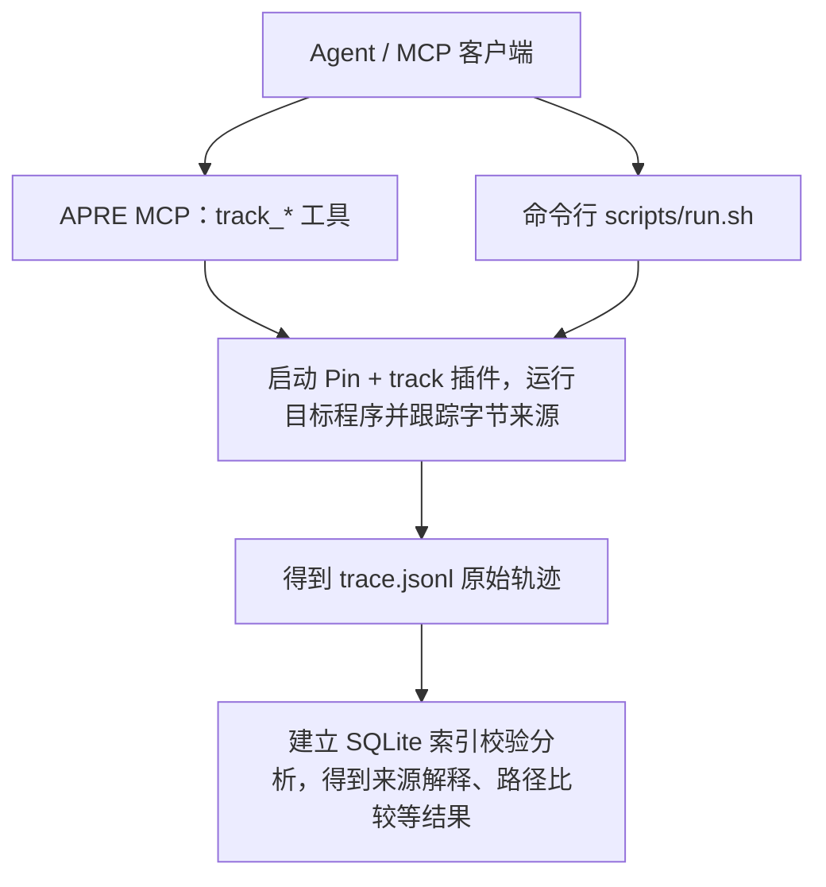

# track 污点追踪

核心：给 rev 输入字节打上来源标签，跟踪标签经过的运算、内存访问和分支

参照：https://github.com/ecnusse/BinPRE

优化目标：给Agent更多信息

| 记录 | 示例 | BinPRE 处理 | track 优化 |
| --- | --- | --- | --- |
| **跟踪输入决定数据** | `result = table[input_byte]` |  `lea` 清除目标污点，不进行传播 | 保留`lea`的传播关系，同时记录“取出的数据来自哪里”和“为什么选中这个位置” |
| **追踪响应数据来源** | 服务端把请求中的编号复制到响应 | 不关注输出字节来源记录 | 保存发送数据及其逐字节标签，并结合实际发送长度输出记录，建立从请求到响应的联系 |
| **污点来源传播** | `result = x输入的字节a + y输入的字节b` | 记录“来自哪一段” ；result 只继承单一来源 | 记录“来自哪几段”；建立集合：{(input_id, offset)，...} | 
| **接收输入覆盖范围** | 同一目标接受报文的函数不同 |  `read()` 、`recvmsg()` 等部分方式没有正确标记污点 | 在系统调用边界注册回调、捕获数据，覆盖更多读取方式，并逐个处理接收区域 |
| **多线程隔离问题** | 两个线程同时处理请求 A、B | 寄存器污点状态共用一份来源记录 | 每个线程保存自己的寄存器标签和调用状态 |
| **局部修改保留来源** | 8 字节输入只将其中最低的 1 字节改动，其他 7 字节没有变化 | 对相关寄存器采用整组更新清除 | 把完整寄存器看成一排字节，按字节更新 |




| 文件 | 职责 |
| --- | --- |
| [src/pretrace.cpp](src/pretrace.cpp) | 采集入口：拦截输入/输出系统调用，分析指令，管理线程状态，写入轨迹。 |
| [src/taint_core.hpp](src/taint_core.hpp) | 来源标签与传播基础：用 `(输入编号, 字节偏移)` 表示来源；为内存和寄存器维护对应标签。 |
| [src/comparison_model.hpp](src/comparison_model.hpp) | 为可识别的导入函数 `strcmp/strncmp/memcmp/bcmp` 补充保守的返回值来源模型。 |
| [../src/tools/track/](../src/tools/track/) | MCP 对应的 Python 实现：运行管理、输入重放、日志索引和证据分析。 |

### 处理流程

1. **启动目标**：Pin 加载插件并运行目标；命令行或 MCP 层提供真实输入。
2. **标记输入**：选中的读取成功返回后，为实际捕获的每个字节分配来源标签，同时保存原始字节。一次读取对应一个 `input_id`，偏移从 0 开始。
3. **跟踪传播**：首次选中输入后，按指令模型更新寄存器和内存标签。记录数据来源、访存地址来源，以及比较、分支和间接跳转的相关证据；网络发送时记录输出字节及其来源。
4. **保存与分析**：产出 JSONL；MCP 层校验记录和引用关系，建立 SQLite 索引，再按输入字节、指令、线程或地址查询。

| 输出记录类型 | 内容 |
| --- | --- |
| `header` | 格式版本、架构和采集模型配置。 |
| `input` / `input_chunk` | 一次读取的 fd、长度、来源类别，以及捕获的原始字节和内存地址。 |
| `tag` | 标签对应哪些 `(input_id, offset)`；标签 0 表示没有已记录来源。 |
| `instruction` | 指令地址、模块及模块内偏移、反汇编、操作数定义。 |
| `step` / `control` | 动态事件序号 `seq`、线程、执行前值、来源标签；控制转移还包含方向和目标。 |
| `model` / `output` | 比较函数返回值的来源模型；成功 socket 发送的字节及来源。 |
| `unsupported_static` / `gap` / `summary` | 插桩时发现的不支持项、采集缺口、结束时统计。静态不支持提示本身不表示该指令已执行。 |


### MCP 工具


| 用途 | MCP 工具 |
| --- | --- |
| 新建或导入轨迹 | `track_run`、`track_import` |
| 看质量、查原始证据、导出 | `track_summary`、`track_query`、`track_export` |
| 找受输入影响的代码、解释事件、追溯候选传播链 | `track_influence`、`track_explain`、`track_slice` |
| 查看分支、路径、内存和数值变化 | `track_branches`、`track_path`、`track_memory`、`track_values` |
| 比较两次运行、换算静态地址 | `track_compare`、`track_compare_paths`、`track_map_address` |

### 一般分析过程

```text
track_run（或 track_import 导入已有日志）
  → track_summary：先看质量和缺口
  → track_query(kind="inputs")：核对实际读取内容及 input_id
  → track_influence(input_id, offset, length)：找受影响的代码
  → track_explain(seq)：解释具体事件
  → 按需查看分支、追溯候选链或比较两次运行
```